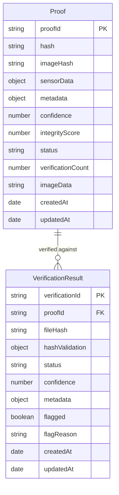

# 🗄️ A.U.R.A. Database Architecture & Setup Guide

## 📌 Overview

The **A.U.R.A. (Authenticity & Reality Verification System)** uses **MongoDB** as its primary document ledger for storing cryptographic media proofs, multi-sensor telemetry readings, EXIF camera metadata, watermarked image markers, and verification audit trails.

The database layer is designed with **fault-tolerant fallback resilience**: if the MongoDB database is unreachable or offline, the backend automatically operates in **Mock API Mode** without throwing server crashes or interrupting mobile camera capture.

---

## 🛠️ Technology Stack & Configuration

- **Database Engine**: MongoDB (MongoDB Atlas Cloud Cluster or Local MongoDB Instance)
- **ODM (Object Document Mapper)**: [Mongoose](https://mongoosejs.com/) (`mongoose` v8.x)
- **Config File**: [`backend/config/config.js`](file:///d:/Projects/Java_Script/Apps/AURA/backend/config/config.js)
- **Environment Variables**: [`backend/.env`](file:///d:/Projects/Java_Script/Apps/AURA/backend/.env)

### Connection Parameters

In `backend/.env`, the MongoDB URI is specified as:

```env
# Database Connection String
MONGODB_URI=mongodb+srv://<user>:<password>@<cluster>.mongodb.net/realityproof?retryWrites=true&w=majority
```

In `backend/config/config.js`, the default fallback is set to local MongoDB if environment variables are not provided:

```javascript
mongodbUri: process.env.MONGODB_URI || 'mongodb://localhost:27017/realityproof',
```

---

## ⚡ Database Connection & Fallback Resilience

The backend establishes the database connection during initialization in [`backend/server.js`](file:///d:/Projects/Java_Script/Apps/AURA/backend/server.js#L29-L38):

```javascript
const connectDatabase = async () => {
  try {
    await mongoose.connect(config.mongodbUri);
    logger.info('✅ MongoDB connected successfully');
    logger.info(`Database: ${config.mongodbUri}`);
  } catch (error) {
    logger.error(`❌ MongoDB connection failed: ${error.message}`);
    logger.warn('Running without database persistence (mock API mode)');
  }
};
```

### Connection State Check (`isDbConnected`)

Controllers check database availability before attempting reads or writes:

```javascript
const isDbConnected = () => mongoose.connection.readyState === 1;
```

- **If Connected (`readyState === 1`)**: Proof documents and audit logs are saved and queried directly in MongoDB.
- **If Disconnected (`readyState !== 1`)**: API endpoints execute calculations in-memory, returning responses with `persistedToDb: false` while maintaining smooth mobile app operation.

---

## 📐 Data Models & Schema Specifications

The database maintains two core collections: `proofs` and `verificationresults`.



---

### 1. `proofs` Collection

- **Model File**: [`backend/models/Proof.js`](file:///d:/Projects/Java_Script/Apps/AURA/backend/models/Proof.js)
- **Purpose**: Stores the authoritative cryptographic proof record for every photo captured in the A.U.R.A. app, including multi-sensor telemetry, EXIF data, and the watermarked media marker.

#### Field Specifications

| Field Name | Type | Index | Description |
| :--- | :--- | :---: | :--- |
| `proofId` | `String` | **Unique** | Unique identifier (e.g. `AURA-8F9A-2B4C-71D2`). Primary lookup key. |
| `hash` | `String` | **Indexed** | SHA-256 hash of the complete sensor telemetry payload and capture metadata. |
| `imageHash` | `String` | **Indexed** | SHA-256 hash of the final watermarked media bytes. Used for pixel integrity matching. |
| `sensorData.accelerometer` | `Array` | - | Sub-documents containing `{ x, y, z, timestamp }` (motion physics). |
| `sensorData.gyroscope` | `Array` | - | Sub-documents containing `{ x, y, z, timestamp }` (orientation stability). |
| `sensorData.magnetometer` | `Array` | - | Sub-documents containing `{ x, y, z, magneticField, timestamp }` (EMF screen defense). |
| `sensorData.light` | `Array` | - | Sub-documents containing `{ lux, timestamp }` (display refresh flicker defense). |
| `sensorData.location` | `Object` | - | `{ latitude, longitude, altitude, accuracy, timestamp, error }`. |
| `sensorData.timestamp` | `Object` | - | Time window details `{ start, end, durationMs, startISO, endISO }`. |
| `metadata` | `Mixed` | - | Flexible schema containing device specs, Google Drive links, and EXIF parameters (`metadata.exif`). |
| `confidence` | `Number` | - | Overall calculated sensor confidence score (`0.0` to `100.0`). |
| `integrityScore` | `Number` | - | Physics & anti-tamper score (`0.0` to `100.0`). |
| `status` | `String` | - | Proof state: `'authentic'`, `'tampered'`, or `'unverified'`. |
| `verificationCount` | `Number` | - | Audit counter incremented each time the proof is verified. Default `0`. |
| `imageData` | `String` | - | Base64-encoded string of the watermarked image containing the A.U.R.A. Certified Seal. |
| `timestamps` | `Date` | - | Automatic `createdAt` and `updatedAt` timestamps generated by Mongoose. |

---

### 2. `verificationresults` Collection

- **Model File**: [`backend/models/VerificationResult.js`](file:///d:/Projects/Java_Script/Apps/AURA/backend/models/VerificationResult.js)
- **Purpose**: Acts as an audit ledger recording every verification check (via Upload, Proof ID, or QR Scan) executed against media items.

#### Field Specifications

| Field Name | Type | Index | Description |
| :--- | :--- | :---: | :--- |
| `verificationId` | `String` | **Unique** | Unique result ID (e.g. `RESULT_a1b2c3d4...`). |
| `proofId` | `String` | **Indexed** | Reference to the target `proofId` verified against. |
| `fileHash` | `String` | - | SHA-256 hash of the uploaded media file being checked. |
| `hashValidation` | `Object` | - | `{ isValid: Boolean, matchPercentage: Number, uploadedHash: String, storedHash: String }`. |
| `status` | `String` | - | Result outcome: `'authentic'`, `'tampered'`, or `'inconclusive'`. |
| `confidence` | `Number` | - | Verification match confidence score (e.g., `99.7` for exact match). |
| `metadata` | `Object` | - | Context of uploaded file: `{ fileName, fileSize, fileMimeType, verifiedAt, verifiedFrom }`. |
| `flagged` | `Boolean` | - | `true` if media tampering or hash mismatch was detected. Default `false`. |
| `flagReason` | `String` | - | Detailed description if flagged for tampering. |
| `timestamps` | `Date` | - | Automatic `createdAt` and `updatedAt` timestamps. |

---

## 📷 EXIF Data & Media Marker Storage Mechanics

### 1. EXIF Metadata Storage

- **Mobile Extraction**: When a photo is taken using Expo Camera in [`frontend/src/screens/CaptureScreen.js`](file:///d:/Projects/Java_Script/Apps/AURA/frontend/src/screens/CaptureScreen.js#L482), `photo.exif` is attached to the request payload as `metadata.exif`.
- **MongoDB Persistence**: The backend stores the entire EXIF payload under `proofs.metadata.exif` in MongoDB. This includes:
  - Camera Manufacturer & Model (`Make`, `Model`)
  - ISO, Exposure Time, F-number (`ExposureTime`, `FNumber`, `ISOSpeedRatings`)
  - EXIF Software & Version (`Software`, `ExifVersion`)
  - Lens Parameters & Focal Length (`FocalLength`)
- **Metadata ML Analysis**: During verification in [`backend/controllers/verify.js`](file:///d:/Projects/Java_Script/Apps/AURA/backend/controllers/verify.js#L307), `exifr` parses 13 EXIF flags in [`backend/utils/metadataAnalyzer.js`](file:///d:/Projects/Java_Script/Apps/AURA/backend/utils/metadataAnalyzer.js#L371) to compute AI vs. Real Camera probability scores.

### 2. Media Marker (A.U.R.A. Certified Watermark Seal) Storage

When a photo passes authenticity checks (`auraFlag === 'GREEN'`), the backend embeds a server-side watermarked seal using `sharp` in [`backend/utils/crypto.js`](file:///d:/Projects/Java_Script/Apps/AURA/backend/utils/crypto.js#L365):

1. **`imageData` Field**: The full base64 string of the watermarked photo (including the A.U.R.A. banner and scannable QR code) is saved in `Proof.imageData`.
2. **`imageHash` Field**: The SHA-256 hash of the final marked image bytes is generated and stored in `Proof.imageHash`.
3. **Verification Matching**: When a user scans the QR code or uploads the watermarked photo, the backend compares the file hash against `Proof.imageHash` to verify pixel-level media integrity.

---

## 🔄 API Routes & Database Interaction Flow

```mermaid
sequenceDiagram
    autonumber
    participant App as Mobile App
    participant Server as Express Server
    participant ProofCtrl as Proof Controller
    participant VerifyCtrl as Verify Controller
    participant DB as MongoDB Atlas

    rect rgb(15, 23, 42)
    note right of App: 1. Generate Proof Flow
    App->>Server: POST /api/media/generate-proof (Media + 6 Sensor Feeds)
    Server->>ProofCtrl: generateAuthenticityProof()
    ProofCtrl->>ProofCtrl: Validate sensors & apply A.U.R.A. watermark
    ProofCtrl->>DB: Proof.save() or findOneAndUpdate()
    DB-->>ProofCtrl: Saved Proof Document
    ProofCtrl-->>App: Return proof JSON & watermarked image
    end

    rect rgb(30, 41, 59)
    note right of App: 2. Verification Flow
    App->>Server: POST /api/media/verify (File Hash or Proof ID)
    Server->>VerifyCtrl: verifyMedia()
    VerifyCtrl->>DB: Proof.findOne({ proofId }) OR Proof.findOne({ imageHash })
    DB-->>VerifyCtrl: Returns stored proof record
    VerifyCtrl->>VerifyCtrl: Compare hashes & calculate confidence
    VerifyCtrl-->>App: Return verification verdict (AUTHENTIC / TAMPERED)
    end

    rect rgb(15, 23, 42)
    note right of App: 3. Audit Logging Flow
    App->>Server: POST /api/verification/store (Result payload)
    Server->>VerifyCtrl: storeVerificationResult()
    VerifyCtrl->>DB: VerificationResult.save()
    DB-->>VerifyCtrl: Saved result ID
    VerifyCtrl-->>App: Confirmation response
    end
```



---

## 🚀 Setup & Execution Guide

### Prerequisites

- Node.js (v18+)
- MongoDB Atlas Account OR Local MongoDB server running on `mongodb://localhost:27017`

### 1. Environment Configuration

Navigate to `backend/.env` and configure your database URI:

```bash
# Production / Cloud Database (MongoDB Atlas)
MONGODB_URI=mongodb+srv://<username>:<password>@cluster0.lz452k4.mongodb.net/realityproof?retryWrites=true&w=majority

# Local Development Database
# MONGODB_URI=mongodb://localhost:27017/realityproof
```

### 2. Running Backend Server

```bash
cd backend
npm install
npm run dev
```

Upon successful startup, the console log will confirm database connectivity:

```text
========================================
   🛡️  A.U.R.A. Backend Server         
========================================
✅ MongoDB connected successfully
Database: mongodb+srv://.../realityproof
✅ Server running on LAN: http://192.168.1.100:3001
🏠 Local address: http://localhost:3001
🛡️  A.U.R.A. Defense Engine: ACTIVE
```

---

## 🔍 Database Troubleshooting

| Issue / Error Message | Cause | Solution |
| :--- | :--- | :--- |
| `❌ MongoDB connection failed: querySrv EREFUSED` | Network DNS issues reaching MongoDB Atlas SRV host. | Verify internet connectivity, or replace `mongodb+srv://` connection string with standard IP seed list. |
| `MongoServerError: bad auth` | Incorrect username or password in `MONGODB_URI`. | Check `.env` credentials and ensure Special Characters in passwords are URL-encoded. |
| `MongoNetworkError: connect ECONNREFUSED 127.0.0.1:27017` | Local MongoDB service is not running. | Start local MongoDB service via `mongod` or Docker (`docker run -d -p 27017:27017 mongo`). |
| `Running without database persistence (mock API mode)` | DB connection failed, but backend initialized in fallback mode. | Check backend logs for the underlying error. The app remains functional in mock mode. |
