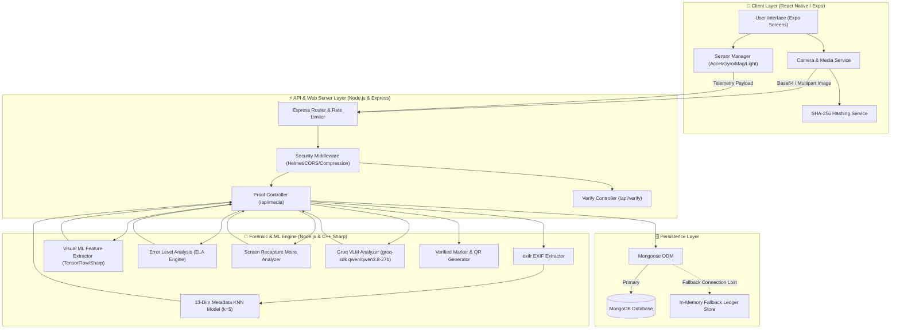
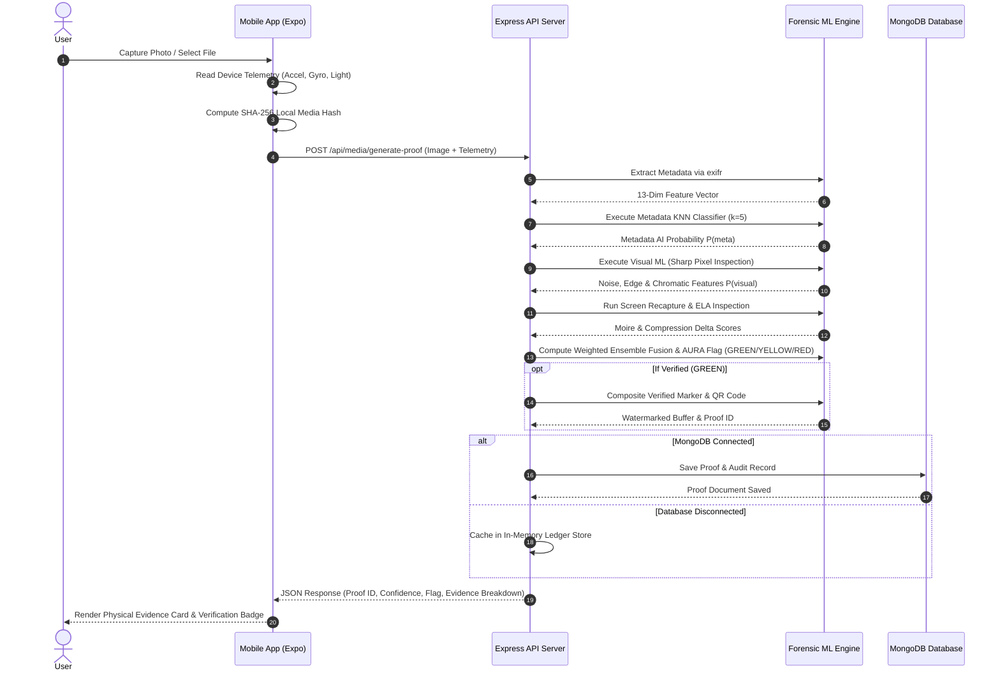

# 🏗️ A.U.R.A. - System Architecture & Data Flow

This document details the high-level and component-level system architecture of **A.U.R.A. (Authenticity Using Reality Analysis)**, illustrating the end-to-end flow of data from mobile camera sensor collection to deep forensic analysis and cryptographic database sealing.

---

## 📐 High-Level Architecture Diagram

---

## 🔄 End-to-End Image Verification Sequence Flow

The following sequence diagram outlines what happens when a user captures or uploads a photo for verification:

---

## 🧩 Core Architectural Components

### 1. Client Application Layer (`frontend/src`)
Built with **React Native** and **Expo SDK 54**, supporting iOS, Android, and Web builds.
- **`screens/CaptureScreen.js`**: Controls the native camera hardware interface, live sensor tracking, and preview frame capture.
- **`screens/VerificationScreen.js`**: Handles file selection, zero-adoption web upload, and API payload dispatch.
- **`screens/ResultScreen.js`**: Visualizes the forensic results, ML scores, and interactive evidence breakdowns.
- **`components/EvidenceCard.js`**: Displays the 13 physical camera signals checked (Make, Model, Shutter Speed, Aperture, ISO, Focal Length, etc.).
- **`components/MLScoreCard.js`**: Displays deep learning confidence gauges, ELA metrics, and screen replay scores.
- **`services/sensorManager.js`**: Reads hardware sensors (`expo-sensors`) at 60Hz to collect accelerometer, gyroscope, magnetometer, barometer, and light metrics.

---

### 2. Backend REST API Layer (`backend/`)
Built with **Node.js** and **Express 4**, operating on HTTP/JSON endpoints.
- **Server Guards & Security**:
  - `helmet`: Protects against standard HTTP header vulnerabilities.
  - `cors`: Configured for cross-origin access between mobile/web clients and server endpoints.
  - `express-rate-limit`: Global API rate limiting to prevent denial-of-service or brute-force verification requests.
  - `compression`: Gzip/Brotli compression middleware for low-latency JSON payload transmission.
- **Router Layer (`backend/routes`)**:
  - `/api/media`: Routes for proof generation, verification, and metadata analysis.
  - `/api/verification`: Routes for audit log queries, stored results, and proof history lookup.
  - `/api/verify`: Unified proof ID verification routes (`/proof/:proofId`, `/scan-qr`).

---

### 3. Forensic & Machine Learning Layer (`backend/utils`)
Operates directly within Node.js memory without requiring slow external Python subprocesses:
- **`metadataAnalyzer.js`**: Parses EXIF data using `exifr` and computes the 13-feature binary vector. Executes an in-memory K-Nearest Neighbors ($k=5$) classification against a ground-truth dataset of 75+ real camera profiles and 75+ AI generator outputs.
- **`visualMLAnalyzer.js`**: Evaluates pixel buffers using Sharp. Computes noise energy, block boundary variance, edge gradient distribution, and chromatic dispersion.
- **`elaAnalyzer.js`**: Re-compresses the image buffer at 90% JPEG quality, computes pixel-wise absolute difference maps, and calculates localized error variance.
- **`screenRecaptureAnalyzer.js`**: Detects monitor screen replays by computing high-frequency luminance ratios, dark pixel threshold counts, and periodic spatial patterns.
- **`crypto.js`**: Handles SHA-256 media hashing, telemetry integrity scoring, proof ID formatting (`AURA-XXXXXX`), and QR code overlay composite generation.

---

### 4. Database & Resilience Layer (`backend/models` & `backend/utils/ledgerStore.js`)
- **Primary Persistence**: **MongoDB** connected via **Mongoose v8.0**.
  - **`Proof` Collection**: Stores cryptographic media hash, device fingerprint, sensor telemetry, EXIF metadata, verification flag (`GREEN`/`YELLOW`/`RED`), and proof payload.
  - **`VerificationResult` Collection**: Stores historical verification lookups, audit trails, and validation matches.
- **Fallback Resilience Engine**: If MongoDB connection drops or is unavailable, `ledgerStore.js` seamlessly catches saves and lookups in an **in-memory Map cache**. Operations continue gracefully without throwing 500 errors to mobile users (`persistedToDb: false`).
